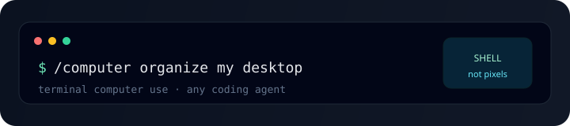

<p align="center">
  
</p>

<h1 align="center">Terminal Computer Use</h1>

<p align="center">
  <strong>Computer Use for any coding agent — via the terminal, not pixel clicking.</strong>
</p>

<p align="center">
  Give Claude Code, Cursor, Codex, Grok, Gemini CLI, and friends<br/>
  real hands on your machine: files, apps, clipboard, desktop.
</p>

<p align="center">
  <a href="https://github.com/vivekkartha/terminal-computer-use/stargazers"></a>
  <a href="LICENSE"></a>
  <a href="https://skills.sh"></a>
  <a href="#install"></a>
</p>

<p align="center">
  <a href="#install">Install</a> ·
  <a href="#quick-start">Quick start</a> ·
  <a href="#what-you-get">Scripts</a> ·
  <a href="#how-it-works">How it works</a> ·
  <a href="#safety">Safety</a> ·
  <a href="#faq">FAQ</a>
</p>

---

## Why people star this

Your coding agent already has a shell.  
**Vision “Computer Use”** burns tokens on screenshots and brittle clicks.  
**Terminal Computer Use** does the same jobs the way a power user would — with scripts.

| | Vision Computer Use | **Terminal Computer Use** |
|--|---------------------|---------------------------|
| How | Screenshots + mouse | Shell + OS automation |
| Cost | Expensive / slow | Cheap / fast |
| Reliability | UI selectors drift | Idempotent CLI ops |
| Remote | Needs a display | Works over SSH |
| Agents | Vendor APIs | **Any agent with a terminal** |

> Organize a messy Desktop. Open Slack. Move PDFs. Notify when done.  
> No cloud computer-use API. No click coordinates.

---

## Install

### One-liner (recommended)

```bash
npx skills add vivekkartha/terminal-computer-use -g
```

### Clone + install

```bash
git clone https://github.com/vivekkartha/terminal-computer-use.git
cd terminal-computer-use
./install.sh
```

Installs into agents it finds on your machine:

| Agent | Path |
|-------|------|
| Grok | `~/.grok/skills/computer/` |
| Claude Code | `~/.claude/skills/computer/` |
| Cursor | `~/.cursor/skills/computer/` |
| Codex / generic | `~/.agents/skills/computer/` |

```bash
./install.sh --dry-run       # preview
./install.sh --symlink       # dev: live-edit the repo
./install.sh --agent claude  # one agent
./install.sh --project       # this repo only
```

**Verify**

```bash
bash ~/.agents/skills/computer/scripts/doctor.sh
# or
bash ~/.grok/skills/computer/scripts/doctor.sh
```

---

## Quick start

### In your coding agent

```text
/computer organize my desktop
/computer open Slack and reveal ~/Downloads
/computer quit Spotify; notify me when done
/computer move PDFs on Desktop into ~/Documents/PDFs — dry-run first
```

### Direct CLI

```bash
SCRIPTS=~/.grok/skills/computer/scripts   # adjust to your install path

# Smart-organize Desktop (preview → apply)
python3 "$SCRIPTS/fs-organize.py" --dry-run ~/Desktop
python3 "$SCRIPTS/fs-organize.py" ~/Desktop

# Paths with spaces work
bash "$SCRIPTS/fs-move.sh" --dry-run ~/Desktop/"report final.pdf" ~/Documents/

bash "$SCRIPTS/notify.sh" --title "Done" "Desktop organized"
```

---

## What you get

### 1. An agent skill (`SKILL.md`)

Portable instructions any CLI agent can follow: when to run which script, safety rules, how to grow the library.

### 2. A real script library (not prompt-only slop)

| Script | What it does |
|--------|----------------|
| `doctor.sh` | Health check for install + tools |
| `fs-organize.py` | **Smart** / extension / date organize |
| `fs-move.sh` / `fs-copy.sh` | Safe move/copy · spaces OK · `--dry-run` |
| `safe-trash.sh` | Trash only — never `rm -rf` |
| `open-target.sh` | Open app, file, folder, URL |
| `quit-app.sh` / `app-activate.sh` | Quit / focus apps |
| `list-apps.sh` / `frontmost-app.sh` | What’s running / focused |
| `clipboard.sh` | get · set · clear |
| `notify.sh` | Desktop notification |
| `screenshot.sh` | Capture screen |
| `reveal-in-finder.sh` | Reveal in file manager |
| `desktop-path.sh` | Cross-OS Desktop / Downloads paths |

Platform glue lives in `scripts/lib/platform.sh` (macOS full · Linux core).

### Smart organize example

```text
Desktop/
  Screenshot 2026-06-19.png  ─┐
  receipt.jpg                 ├─→  Screenshots/  Images/  Documents/
  invoice.pdf                 ─┘
```

```bash
python3 scripts/fs-organize.py --by smart --dry-run ~/Desktop
python3 scripts/fs-organize.py --by smart ~/Desktop
# also: --by extension | --by date
```

---

## How it works

```text
  You  ──►  Coding agent  (/computer or natural language)
                │
                ▼
           SKILL.md     (when / what / safety)
                │
                ▼
           scripts/*    (bash + python)
                │
                ▼
           Your OS      (open, mv, osascript, xdg-open, …)
```

Works with **Claude Code, Cursor, Codex, Grok, Gemini CLI, OpenCode**, and anything that can run shell commands and load [Agent Skills](https://skills.sh).

---

## Platform support

| Capability | macOS | Linux | Windows |
|------------|:-----:|:-----:|:-------:|
| Organize / move / copy / trash | ✅ | ✅ | soon |
| Open / reveal | ✅ | ✅ | soon |
| Clipboard / notify | ✅ | ✅* | soon |
| Apps (list / quit / focus) | ✅ | best-effort | soon |
| Screenshots | ✅ | ✅* | soon |

\* Needs common desktop tools (`xdg-open`, `notify-send`, `wl-copy` / `xclip`).

---

## Safety

This skill can **move files and quit apps**. Treat it like a careful assistant with a shell.

| Guardrail | Detail |
|-----------|--------|
| `--dry-run` | On all mutating file scripts |
| `TCU_SAFE_MODE=1` | Forces dry-run on mutators |
| `safe-trash.sh` | Trash only — no silent `rm -rf` |
| Path guards | Refuses `$HOME`, `/`, system paths |
| Installer | Won’t clobber unmanaged dirs without `--force` |
| Force-quit | Exact process name only (no substring `pkill`) |

See [SECURITY.md](SECURITY.md) and [skills/computer/references/safety.md](skills/computer/references/safety.md).

---

## Demo

```bash
./demos/scripts/demo-organize.sh
```

Creates a fixture folder, dry-runs smart organize, then applies it.

---

## Development

```bash
git clone https://github.com/vivekkartha/terminal-computer-use.git
cd terminal-computer-use
./install.sh --symlink --agent grok

bash tests/test_scripts_help.sh
bash tests/test_fs_move.sh
python3 tests/test_fs_smart_organize.py
bash tests/test_install_dry.sh
```

See [CONTRIBUTING.md](CONTRIBUTING.md).

---

## FAQ

**Is this Anthropic Computer Use / OpenAI Operator?**  
No. Those drive a GUI with vision. This uses the **terminal** — faster, cheaper, scriptable, SSH-friendly.

**Will it work with my agent?**  
If your agent can run shell commands and load a `SKILL.md` (or you point it at the scripts), yes.

**Does it delete my files?**  
Default mutators move/copy/trash with dry-run support. There is no bulk `rm -rf` helper.

**macOS permissions?**  
Automation and screenshots may need Accessibility / Automation / Screen Recording for your terminal app under System Settings → Privacy & Security.

---

## Not this project

- ❌ Browser automation → [agent-browser](https://github.com/vercel-labs/agent-browser), Playwright  
- ❌ Pixel-level GUI Computer Use APIs  
- ❌ A dump of hundreds of AI-generated skill files  

**One sharp product:** terminal-native desktop ops for agents.

---

## Star & share

If this saves you time:

```text
Terminal Computer Use — Computer Use for any coding agent, via the shell.
https://github.com/vivekkartha/terminal-computer-use

npx skills add vivekkartha/terminal-computer-use -g
```

---

## License

[MIT](LICENSE) © 2026 Vivek Kartha
